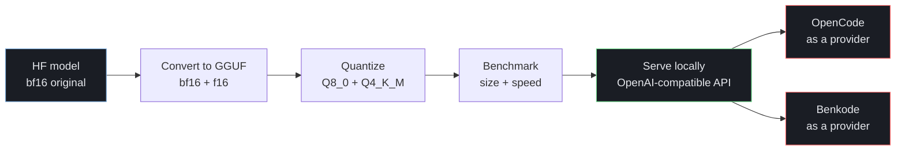

# local-deployment

Compress an open model to different precision levels, measure the real
size/speed tradeoffs, and serve the result locally through an
OpenAI-compatible API — usable as a drop-in provider for tools like OpenCode
or Benkode. Tested end to end with both.

## Pipeline



## Model

[Qwen2.5-1.5B-Instruct](https://huggingface.co/Qwen/Qwen2.5-1.5B-Instruct) —
small enough to iterate on quickly, Apache 2.0 licensed, released by Qwen in
**bf16** (confirmed by inspecting the original `.safetensors` tensor dtype
directly — bf16 is the real, unmodified baseline, not fp32; most modern
models ship this way since fp32 storage adds no benefit training didn't
already need).

This pipeline isn't specific to this one model — **any model llama.cpp
supports** can be substituted (most popular open models on Hugging Face:
Llama, Mistral, Qwen, Gemma, Phi, and others). Swap the model name in the
download and convert commands below; the rest of the pipeline is unchanged.

## Why llama.cpp, and what changes with a different engine

llama.cpp was chosen here because it's CPU-friendly, has no heavyweight
dependencies, and its `llama-server` gives an OpenAI-compatible API out of
the box — good fit for local, non-GPU-guaranteed deployment. Other inference
engines (vLLM, TGI, Ollama, LM Studio) can also quantize and serve models,
often with better GPU throughput, but each has its own tools, flags, and
serving setup — the general idea (compress → benchmark → serve → use as a
provider) carries over, but the specific commands here are llama.cpp-specific;
check that engine's own documentation for its equivalent steps.

## What "quantization" actually means here

Four formats were produced and compared:

| Format | What it is | Compression? |
|---|---|---|
| **BF16** | The original — no change | Baseline |
| **F16** | Same 16-bit width as BF16, different exponent/mantissa split (5+10 bits vs. BF16's 8+7) | Not really — same size, different numeric tradeoffs |
| **Q8_0** | Real quantization — 8-bit integer weights | Yes |
| **Q4_K_M** | Real quantization — ~4-bit integer weights (mixed precision per layer, hence "K_M") | Yes |

BF16 and F16 are included for a complete comparison, but the real compression
story is BF16 → Q8_0 → Q4_K_M.

## Results — measured, not estimated

Benchmarked with `llama-bench`, CPU only, on an **Intel Core i7-11370H
(11th Gen, 3.30GHz)**. GPU benchmarking was attempted but blocked by an
unrelated NVIDIA driver/kernel mismatch on the test machine, unrelated to
this project — CPU numbers below are real, complete, and the ones this
project is built around.

| Format | Size | Prompt processing | Generation | Size reduction |
|---|---|---|---|---|
| BF16 (original) | 2.88 GiB | 73.4 t/s | 10.8 t/s | — |
| F16 | 2.88 GiB | 82.5 t/s | 11.5 t/s | 0% |
| Q8_0 | 1.53 GiB | 88.9 t/s | 20.4 t/s | 47% smaller |
| Q4_K_M | 935 MiB | 121.0 t/s | 31.1 t/s | 68% smaller |

**Size (lower is better):**
```
BF16     ████████████████████████████████████████  2.88 GiB
F16      ████████████████████████████████████████  2.88 GiB
Q8_0     █████████████████████                      1.53 GiB
Q4_K_M   █████████████                               0.91 GiB
```

**Generation speed (higher is better):**
```
BF16     ██████████████                              10.8 t/s
F16      ███████████████                              11.5 t/s
Q8_0     ███████████████████████████                  20.4 t/s
Q4_K_M   █████████████████████████████████████████    31.1 t/s
```

**Q4_K_M is roughly 3x faster at generation than the original, at less than
a third of the size** — on CPU alone, no GPU involved. This is the practical
case for local deployment: smaller and faster, not a quality-for-size
tradeoff that only pays off on paper.

## A real limitation worth being honest about

Quantization didn't hurt correctness on the calculator test — 34×19=646 was
right every time, every format. But on a question requiring web search and
synthesis (asking for today's date), the quantized 1.5B model correctly chose
to search rather than guess, but was noticeably weaker at actually reading
and synthesizing the search results into a clean answer than a larger cloud
model would be. Small local models are a real, working option for tasks like
tool-calling and calculation; they're not yet a full replacement for a large
cloud model on tasks needing strong reasoning over retrieved information.

## Reproducing this

**Requirements:**
- Python 3.10+, `pip`
- `cmake` and a C/C++ compiler (`gcc`/`g++` or equivalent) — needed to build llama.cpp
- `git`
- ~10GB free disk space (original model + 4 converted/quantized versions)
- A virtual environment is recommended (`python3 -m venv venv && source venv/bin/activate`) to keep dependencies isolated from your system Python

```bash
# 1. Get the tools
git clone --depth 1 https://github.com/ggerganov/llama.cpp.git
pip install -r llama.cpp/requirements/requirements-convert_hf_to_gguf.txt
cmake -B llama.cpp/build -S llama.cpp -DGGML_NATIVE=OFF -DLLAMA_CURL=OFF
cmake --build llama.cpp/build --config Release -j$(nproc)

# 2. Get the model
pip install huggingface_hub
huggingface-cli download Qwen/Qwen2.5-1.5B-Instruct --local-dir ./models/Qwen2.5-1.5B-Instruct

# 3. Convert to GGUF (original precision, two 16-bit formats)
python3 llama.cpp/convert_hf_to_gguf.py ./models/Qwen2.5-1.5B-Instruct --outtype bf16 --outfile ./models/qwen-bf16.gguf
python3 llama.cpp/convert_hf_to_gguf.py ./models/Qwen2.5-1.5B-Instruct --outtype f16  --outfile ./models/qwen-f16.gguf

# 4. Quantize (the actual compression)
./llama.cpp/build/bin/llama-quantize ./models/qwen-f16.gguf ./models/qwen-q8_0.gguf    Q8_0
./llama.cpp/build/bin/llama-quantize ./models/qwen-f16.gguf ./models/qwen-q4_k_m.gguf  Q4_K_M

# 5. Benchmark each -- this also doubles as a smoke test: each command loads
# the model and runs real inference, so a broken build or corrupted file
# will fail here rather than silently later.
./llama.cpp/build/bin/llama-bench -m ./models/qwen-bf16.gguf
./llama.cpp/build/bin/llama-bench -m ./models/qwen-f16.gguf
./llama.cpp/build/bin/llama-bench -m ./models/qwen-q8_0.gguf
./llama.cpp/build/bin/llama-bench -m ./models/qwen-q4_k_m.gguf
```

## Serving it locally

```bash
./serve.sh                          # serves Q4_K_M by default, port 8080
./serve.sh ./models/qwen-q8_0.gguf  # or serve a different format
```

This starts an OpenAI-compatible API at `http://localhost:8080/v1` — any
tool that can point at a custom OpenAI base URL can use this model as its
backend.

## Using it as a provider

Both tested and confirmed working end to end.

**With Benkode / the harness:**

[Benkode](../../../benkode-release) is a personal AI agent (CLI + web UI)
built on the `agent-harness` engine — it can talk to any OpenAI-compatible
backend, including this locally-served model.

```bash
benkode --provider local --model qwen-q4_k_m
```
(the `local` provider preset already points at `http://localhost:8080/v1`
by default)

**With OpenCode:**

Create `~/.config/opencode/opencode.json`:
```json
{
  "$schema": "https://opencode.ai/config.json",
  "provider": {
    "llama.cpp": {
      "npm": "@ai-sdk/openai-compatible",
      "name": "llama.cpp (local)",
      "options": {
        "baseURL": "http://127.0.0.1:8080/v1"
      },
      "models": {
        "qwen-q4_k_m": { "name": "qwen-q4_k_m" }
      }
    }
  }
}
```
With `serve.sh` running, start OpenCode and select the `llama.cpp` provider —
no API key needed for a local server.

## License

The code here is free to reuse. The model itself (Qwen2.5-1.5B-Instruct) is
Apache 2.0 licensed by Qwen/Alibaba — not redistributed in this repo (see
`.gitignore`); reproduce it yourself with the commands above.
